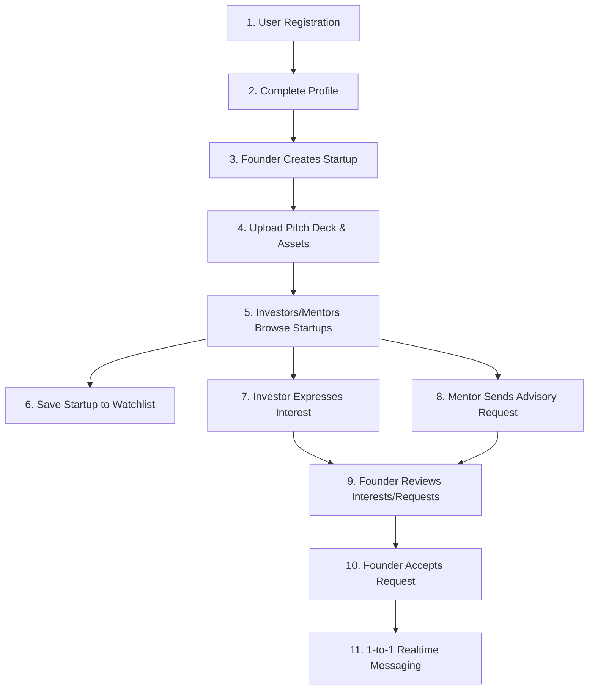

# UDAAN Innovation Platform

UDAAN is a full-stack platform connecting **Founders (Innovators)**, **Investors (Sponsors)**, and **Mentors** to accelerate startup incubation, funding, advisory, and real-time collaboration.

---

## 🔄 End-to-End User Flow



1. **User Registration & Auth**: Signup as an Innovator (Founder), Sponsor (Investor), or Mentor.
2. **Profile Completion**: Update profile details, bio, skills, LinkedIn/social links, and contact information.
3. **Launch Startup**: Founders launch new ventures with details on domain, stage, and funding goals.
4. **Pitch Deck Upload**: Secure file upload of pitch decks, logos, and cover images to Supabase Storage.
5. **Discovery & Browse**: Investors and Mentors filter ventures by industry domain and funding stage.
6. **Watchlist Management**: Investors save promising startups to their personal watchlist.
7. **Investor Interest**: Investors express funding interest with customized notes.
8. **Mentorship Advisory**: Mentors submit mentorship requests to founders.
9. **Founder Review**: Founders manage received investor interest and mentorship requests.
10. **Request Acceptance**: Founders accept mentorship or investor connections.
11. **Realtime Messaging**: Instant 1-to-1 chat between connected users powered by Supabase Realtime.

---

## 🏗️ Architecture & Project Structure

The project follows a **Modular Monolith** architecture with clean separation of concerns:

```
UDAAN/
├── backend/
│   ├── src/
│   │   ├── config/          # Environment & Supabase single client
│   │   ├── middleware/      # Auth, global error handler, validators
│   │   ├── modules/
│   │   │   ├── auth/        # Auth controller, service, routes
│   │   │   ├── startup/     # Startup CRUD, watchlist, interest, mentor requests
│   │   │   ├── upload/      # Supabase Storage bucket uploads
│   │   │   └── messages/    # 1-to-1 Realtime messaging
│   │   ├── utils/           # ApiError, ApiResponse, constants, validators
│   │   ├── app.js           # Express app definition & route binding
│   │   └── server.js        # Node.js server entry point
│   ├── Dockerfile
│   └── package.json
│
├── frontend/
│   ├── src/
│   │   ├── api/             # Axios instance & TanStack Query custom hooks
│   │   ├── components/      # Reusable UI components (Navbar, Sidebar, Modal, Card)
│   │   ├── pages/           # Dashboard, Discover, Projects, Messages, Watchlist, Profile
│   │   ├── store/           # Zustand state management stores
│   │   ├── utils/           # Protected routes, role guards, helpers
│   │   ├── App.jsx          # Router & page lazy loading
│   │   └── main.jsx         # Application entry
│   ├── Dockerfile
│   └── package.json
│
├── docker-compose.yml       # Orchestrates frontend, backend & Nginx proxy
├── nginx.conf               # Production reverse proxy
└── .github/workflows/ci.yml # Automated CI pipeline
```

---

## ⚡ Tech Stack

| Domain | Technology |
| :--- | :--- |
| **Frontend** | React 19, Vite, Tailwind CSS 4, TanStack Query (v5), Zustand, React Hook Form, Zod, React Hot Toast, Lucide React |
| **Backend** | Node.js (v20), Express, Supabase JS SDK, JWT Auth, Multer, Helmet, Morgan, Swagger UI Express |
| **Database & Storage** | Supabase PostgreSQL, Supabase Auth, Supabase Storage Buckets |
| **Realtime Messaging** | Supabase Realtime Channels (1-to-1 Founder ↔ Investor / Mentor messaging) |
| **Deployment** | Docker, Nginx, Docker Compose, GitHub Actions |

---

## 🚀 Getting Started

### Prerequisites
- Node.js 20+
- npm or yarn
- Docker & Docker Compose (optional for containerized deployment)

### 1. Environment Setup

Create `.env` inside `backend/`:

```env
PORT=8000
NODE_ENV=development
CLIENT_ORIGIN=http://localhost:5173
SUPABASE_URL=https://your-supabase-project.supabase.co
SUPABASE_ANON_KEY=your-supabase-anon-key
SUPABASE_SERVICE_ROLE_KEY=your-supabase-service-role-key
JWT_ACCESS_SECRET=access-secret-key
JWT_REFRESH_SECRET=refresh-secret-key
```

### 2. Local Development

**Start Backend**:
```bash
cd backend
npm install
npm run dev
```
- Server: `http://localhost:8000`
- Interactive Swagger API Documentation: `http://localhost:8000/api/docs`

**Start Frontend**:
```bash
cd frontend
npm install
npm run dev
```
- App: `http://localhost:5173`

---

## 🐳 One-Command Docker Deployment

To launch the full production environment with Nginx reverse proxy:

```bash
docker-compose up -d --build
```

- Web Application: `http://localhost`
- API Gateway: `http://localhost/api/`
- Interactive API Docs: `http://localhost/api/docs`

---

## 🧪 Testing

Run backend integration test suite:

```bash
cd backend
npm test
```

Run frontend build check:

```bash
cd frontend
npm run build
```

---

## 📄 API Documentation

Interactive Swagger OpenAPI specs are served at **`/api/docs`** on the backend server.
