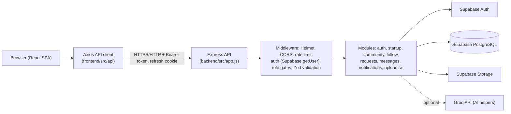
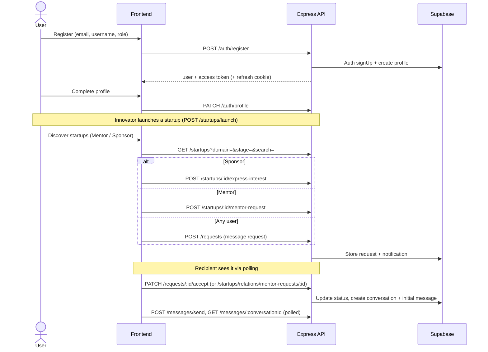

# UDAAN — Innovation and Startup Ecosystem Platform

UDAAN is a web platform that connects **Innovators** (people building startups), **Mentors** (people offering guidance) and **Sponsors** (people interested in backing startups). Innovators publish startup profiles; Mentors and Sponsors discover them and reach out; accepted requests open a private conversation.

It addresses a common gap in early-stage ecosystems: founders, mentors and funders usually meet through scattered informal channels. UDAAN puts discovery, structured requests (mentorship, sponsor interest, message requests), messaging and notifications in one role-aware application.

> **Status:** the repository contains a working React frontend and Express API that use [Supabase](https://supabase.com) for authentication, PostgreSQL and file storage. Automated backend tests pass against an in-memory fake of Supabase. **Live Supabase integration, a deployed environment and browser/end-to-end behaviour have not been verified as part of this documentation.** Funding is a **demo-only simulation**. See [Known Limitations](#16-known-limitations-and-current-status).

## Table of Contents

1. [Project Overview](#1-project-overview)
2. [Key Features](#2-key-features)
3. [User Roles and Permissions](#3-user-roles-and-permissions)
4. [Technology Stack](#4-technology-stack)
5. [System Architecture](#5-system-architecture)
6. [Repository Structure](#6-repository-structure)
7. [Prerequisites](#7-prerequisites)
8. [Environment Configuration](#8-environment-configuration)
9. [Installation and Local Development](#9-installation-and-local-development)
10. [API Documentation](#10-api-documentation)
11. [Database and Data Model](#11-database-and-data-model)
12. [Security and Data Handling](#12-security-and-data-handling)
13. [Testing and Quality Checks](#13-testing-and-quality-checks)
14. [Docker and Deployment](#14-docker-and-deployment)
15. [Troubleshooting](#15-troubleshooting)
16. [Known Limitations and Current Status](#16-known-limitations-and-current-status)
17. [Contributing](#17-contributing)
18. [License](#18-license)
19. [Acknowledgements](#19-acknowledgements)

---

## 1. Project Overview

| Aspect | Description |
| --- | --- |
| What it does | Lets Innovators create and manage startup profiles, and lets Mentors and Sponsors discover them, express interest, request mentorship and message each other. |
| Who uses it | Three roles: **Innovator**, **Mentor**, **Sponsor** (see [roles](#3-user-roles-and-permissions)). |
| Value | One role-aware workspace for discovery, introductions, mentorship requests, sponsor interest, messaging and activity notifications. |

**How the modules fit together**

- **Accounts** are managed by Supabase Auth. Each auth user has a matching row in the application's `profiles` table that stores the role and public profile data.
- **Startups** are created by Innovators, with team members, progress updates and an optional pitch deck link/upload.
- **Discovery** (startup list, trending, activity feed, community directory) feeds the **request modules**: sponsor interest, mentorship requests and generic message requests.
- An **accepted message request** creates a **conversation**; both parties can then exchange messages. Each step generates **notifications**.

## 2. Key Features

Status legend: **Implemented** = present in code and exercised by the backend test suite (fake database); **Optional** = needs extra configuration; **Demo** = simulated.

### Authentication and account management
- **Implemented** — Register (email, password ≥ 8 chars, full name, unique username, role) and log in with **email or username** through Supabase Auth.
- **Implemented** — Access token returned in the response body (sent as `Authorization: Bearer`); refresh token stored in an `httpOnly` cookie; the frontend refreshes transparently once on a `401`.
- **Implemented** — If email confirmation is enabled in the Supabase project, registration returns `requiresEmailConfirmation` and login is refused (`403`) until confirmed.
- **Implemented** — Missing profile rows are created automatically from auth metadata (`ensureProfile`).
- **Implemented** — Username availability check, logout (revokes the Supabase session, clears the cookie).

### User profiles and role-based experiences
- **Implemented** — Profile fields: name, username, bio, avatar URL, college, specialization, company, designation, location, skills, GitHub/LinkedIn/portfolio URLs, WhatsApp number; a server-computed `profile_completed` flag (≥ 80 % completion).
- **Implemented** — Role-specific navigation and route guards in the frontend (`frontend/src/utils/roles.js`, `routes.jsx`).

### Startup creation and management (Innovators)
- **Implemented** — Create ("launch"), edit startups; the creator is also added to `startup_members` as `Founder`.
- **Implemented** — Add/remove team members by username or user id (founder cannot be removed).
- **Implemented** — Startup updates/announcements (team members post; author or owner deletes).
- **Implemented** — Per-startup analytics for the owner (saved count, interest count, mentor-request count, funding progress).

### Startup discovery and filtering
- **Implemented** — `GET /api/startups` with filters `owner` (`me` or a user id), `domain`, `stage` (`Idea`/`MVP`/`Scale`, case-insensitive substring mapping) and `search` (title/description). Results are capped server-side and ordered newest first.
- **Implemented** — Trending startups and a platform activity feed.

### Community and networking
- **Implemented** — Community directory with filters (`role`, `search`, `college`, `company`, `specialization`, `sort`, `limit`), member search, public member profiles with follow state.
- **Implemented** — Follow/unfollow **users**; list followers and following. (Following a *startup* is **not** implemented in the API, although older docs mention it.)

### Saved startups
- **Implemented** — Toggle-save a startup; list saved startups (used by the Sponsor "Watchlist" page).

### Sponsor interest and mentorship requests
- **Implemented** — Sponsors record interest in a startup (stored in `investor_interest`, one per sponsor/startup, not for own startup).
- **Implemented** — Mentors send mentorship requests (stored in `mentor_requests`, one pending per mentor/startup); the startup owner accepts or rejects them; the mentor is notified.

### Messaging and notifications
- **Implemented** — Generic **message requests** (`/api/requests`): a recipient accepts or rejects; accepting creates the conversation and stores the optional initial message. Messaging without an accepted request is refused (`403`).
- **Implemented** — Conversations, message history, send, mark-as-read.
- **Implemented, polling-based** — The frontend refreshes data with TanStack Query intervals (messages every 5 s, conversations and requests every 15 s, others 30–60 s). **No WebSocket / Supabase Realtime subscription exists in the code.**
- **Implemented** — Notifications list with unread count, mark one / mark all read. Notifications are created as side effects (follow, interest, requests, accept/reject).

### File uploads and pitch decks
- **Implemented** — `POST /api/upload` (multipart field `file`, optional `bucket`) stores a file in a Supabase Storage bucket under `<userId>/<timestamp>_<name>` and returns the public URL. Pitch deck URL is saved on the startup via startup update.
- The Storage buckets must already exist in the Supabase project (not created by this repo).

### AI capabilities
- **Optional** — Four Groq-backed helpers (`bio`, `startup-description`, `startup-name`, `elevator-pitch`) using model `llama-3.3-70b-versatile`. Without `GROQ_API_KEY` the endpoints return `503`. The frontend currently wires up **bio generation** (Settings page) in the pages inspected.

### Funding / investment simulation
- **Demo** — `POST /api/startups/:id/invest` validates input and returns a labelled simulation (`simulated: true`, `persisted: false`, reference `SIM-…`). **Nothing is persisted, no payment is processed, and `startups.funding_received` is never modified.** Use *express interest* for a real, recorded signal.

## 3. User Roles and Permissions

Roles are stored in `profiles.role` as `INNOVATOR`, `MENTOR`, `SPONSOR` (legacy aliases `FOUNDER` → Innovator and `INVESTOR` → Sponsor are normalised; unknown values grant no privileges). Backend enforcement is by the `allowedRoles([...])` middleware in `backend/src/middleware/auth.js` plus ownership checks in the service layer.

| Role | Primary purpose | Verified capabilities | Important restrictions |
| --- | --- | --- | --- |
| **Innovator** | Build and present startups | Launch/edit startups; manage team; post updates; view own analytics; view sponsor interests and mentorship requests on own startups; accept/reject mentorship requests | Edit/analytics/team actions require being the startup **owner** (`founder_id`). Cannot send sponsor interest or mentorship requests. |
| **Mentor** | Offer guidance to startups | Browse startups; send mentorship requests; view own requests | Cannot create startups. Cannot mentor own startup. |
| **Sponsor** | Find startups to back | Browse startups; express interest; run the funding simulation; view own interests; maintain a watchlist | Cannot fund/express interest in own startup. Simulation does not move money. |
| **All authenticated users** | — | Startup list/detail/trending/activity, save startup, community directory, follow users, message requests and conversations, notifications, uploads, AI helpers | Messaging is limited to conversation participants and requires an accepted request. |

Notes:
- Frontend route guards (e.g. `/projects`, `/mentors` for Innovators; `/sponsor/watchlist` for Sponsors) are conveniences; authorization is decided by the API.
- Observation: `PATCH /api/auth/profile` accepts `role`, so a signed-in user can change their own role. Whether that is intended is not documented in the repository.
- Observation: the upload and AI endpoints are available to every authenticated role.

## 4. Technology Stack

Versions are the semver ranges declared in `package.json`.

| Layer | Technology |
| --- | --- |
| **Frontend** | React `^19.2`, Vite `^8`, JavaScript (JSX), React Router `^7`, Tailwind CSS `^4` (`@tailwindcss/vite`), Zustand `^5` (state), TanStack Query `^5` (data fetching), Axios, react-hook-form + `@hookform/resolvers`, Zod `^4`, react-hot-toast, lucide-react, clsx + tailwind-merge |
| **Backend** | Node.js (CommonJS), Express `^4.18`, Zod `^3.22` (validation), Helmet, CORS, `express-rate-limit`, Morgan, cookie-parser, Multer `^2` (memory storage), Axios, swagger-ui-express, dotenv, nodemon (dev) |
| **Database and authentication** | Supabase: Auth + PostgreSQL via `@supabase/supabase-js ^2` (backend uses it for all data access) |
| **File storage** | Supabase Storage (public bucket URLs) |
| **Realtime** | None. Messaging/notifications are HTTP + client polling. |
| **Testing and quality** | Node built-in test runner (`node --test`), in-memory Supabase fake (`backend/test/helpers/fakeSupabase.js`), ESLint 9 with react-hooks / react-refresh plugins |
| **Deployment and infrastructure** | Dockerfiles for both apps, `docker-compose.yml`, `nginx.conf`, GitHub Actions CI, `frontend/vercel.json` (SPA rewrite) |
| **External APIs / AI** | Groq Chat Completions API (`llama-3.3-70b-versatile`), optional |

`@supabase/supabase-js` is listed in `frontend/package.json` but no frontend source imports it; all browser traffic goes through the Express API.

## 5. System Architecture

The browser never talks to Supabase directly. The Express API verifies the Supabase access token on each request, loads the caller's role from `profiles`, enforces authorization, and then accesses the database with a service-role client.



Primary user workflow:



Note: sponsor interest and mentorship requests are stored in their own tables and notify the owner. They do **not** create a conversation by themselves; a conversation is created only when a message request is accepted.

## 6. Repository Structure

```text
.
├── README.md
├── WORKFLOW_INDEX.md           # Index of 30 workflows with diagrams (may be partly outdated, see §16)
├── 01_…30_*_workflow.png       # Workflow diagrams referenced by WORKFLOW_INDEX.md
├── docker-compose.yml          # backend + frontend containers
├── nginx.conf                 # reverse-proxy example (not wired into compose, see §14)
├── .github/workflows/ci.yml    # CI: backend tests, frontend build
├── backend/
│   ├── package.json            # scripts: start, dev, test, test:live-legacy
│   ├── .env.example
│   ├── Dockerfile, nodemon.json
│   ├── src/
│   │   ├── server.js           # entry point: validates env, starts HTTP server
│   │   ├── app.js              # middleware, /health, /api/docs, route registration
│   │   ├── config/             # env.js, supabase.js (clients), schema.js (DB contract), swagger.js
│   │   ├── middleware/         # auth.js (authenticate, allowedRoles), validation.js, error.js
│   │   ├── modules/            # auth, startup, community, follow, requests, messages,
│   │   │                       # notifications, upload, ai  (routes → controller → service)
│   │   │   └── common/profiles.js
│   │   └── utils/              # ApiError, ApiResponse, constants (roles, stage/bucket maps), db helpers, validators
│   ├── test/                   # auth.test.js, ecosystem.test.js, helpers/{harness,fakeSupabase,devServer}.js
│   ├── test-integration.js     # legacy live-server script (old API contract)
│   └── test-supabase.js        # legacy live script
└── frontend/
    ├── package.json            # scripts: dev, build, lint, preview
    ├── .env.example, vite.config.js, eslint.config.js, vercel.json, Dockerfile
    └── src/
        ├── main.jsx, App.jsx   # bootstrap, routes, QueryClient
        ├── api/                # axios.js (client + refresh), api.js (endpoint wrappers), hooks.js (TanStack Query)
        ├── store/              # Zustand: authStore, startupStore, mentorStore, investorStore, uiStore
        ├── hooks/              # useAuth, useStartup, useMentor, useInvestor
        ├── pages/              # Landing, Login, Dashboard, Projects, Discover, Community, Watchlist,
        │                       # Mentors, Messages, Notifications, Profile, Settings, NotFound
        ├── components/         # Navbar, Sidebar, Modal, Card, Button, Input, Loader, InvestmentModal
        ├── config/env.js       # reads VITE_* variables
        └── utils/              # roles.js, routes.jsx (guards), constants, helpers
```

`backend/mock-storage/` and `backend/uploads/` are git-ignored local artefacts. `node_modules/` and `frontend/dist/` are generated.

## 7. Prerequisites

- **Node.js 20 or newer** and **npm**. CI and both Dockerfiles use Node 20; the repository has no `engines` field.
- A **Supabase project** with Auth enabled, the database tables listed in [§11](#11-database-and-data-model), and Storage buckets for uploads (`pitch-decks`, `startup-logos`, `startup-covers`, `avatars`, `startup-updates`, `startup-documents` are the names the API maps to). This repository contains **no SQL migrations**; the schema is assumed to exist.
- Optional: a [Groq](https://groq.com) API key for the AI helpers.
- Optional: Docker and Docker Compose.

## 8. Environment Configuration

Copy the examples; real `.env` files are git-ignored (`.gitignore` ignores `.env*` except `.env.example`).

### Backend — `backend/.env`

| Variable | Required | Purpose | Server-side only |
| --- | --- | --- | --- |
| `SUPABASE_URL` | Yes | Project URL, e.g. `https://your-project-ref.supabase.co` | Yes |
| `SUPABASE_ANON_KEY` | Yes | Anon/publishable key; used for sign-up, sign-in, refresh | Yes (kept in API) |
| `SUPABASE_SERVICE_ROLE_KEY` | Yes | Privileged key for all database/storage access | **Yes — never expose** |
| `PORT` | No (default `8000`) | API port | — |
| `NODE_ENV` | No (default `development`) | `production` enables secure cookies, rate limiting, `trust proxy`, generic 5xx messages | — |
| `CLIENT_URL` | No (default `http://localhost:5173`) | Allowed CORS origin(s), comma-separated | — |
| `API_PREFIX` | No (default `/api`) | API route prefix. Note: the Swagger UI is always mounted at `/api/docs` | — |
| `GROQ_API_KEY` | No | Enables AI helpers; blank → `503` from `/api/ai/*` | **Yes** |
| `MAX_FILE_SIZE` | No | Defined in `env.js`/`.env.example` but the upload route currently hard-codes a 10 MiB Multer limit | — |

The server exits at startup if any `SUPABASE_*` variable is empty or still contains a placeholder (`your-`, `example.com`, `changeme`).

### Frontend — `frontend/.env`

| Variable | Required | Purpose |
| --- | --- | --- |
| `VITE_API_URL` | No | API base URL, e.g. `http://localhost:8000/api`. Defaults to that in dev and to same-origin `/api` in production builds. |
| `VITE_APP_NAME` | No | Display name (default `UDAAN`) |
| `VITE_APP_VERSION` | No | Display version |
| `VITE_MAX_UPLOAD_SIZE` | No | Client-side upload limit in bytes (default 10485760) |

> **Security:** every `VITE_*` variable is embedded in the public browser bundle. Never put the service-role key, the anon key used by the API, `GROQ_API_KEY` or any other secret in a `VITE_*` variable, and never commit `.env` files.

## 9. Installation and Local Development

```bash
git clone <repository-url> udaan
cd udaan

# Backend
cd backend
cp .env.example .env        # then edit SUPABASE_URL, SUPABASE_ANON_KEY, SUPABASE_SERVICE_ROLE_KEY
npm install
npm run dev                 # nodemon on http://localhost:8000  (or: npm start)

# Frontend (second terminal)
cd frontend
cp .env.example .env        # defaults already point at http://localhost:8000/api
npm install
npm run dev                 # Vite on http://localhost:5173
```

| Item | URL |
| --- | --- |
| Frontend (Vite default port) | <http://localhost:5173> |
| API | <http://localhost:8000/api> |
| Health check | <http://localhost:8000/health> (`?deep=false` skips the database check; returns `503` if Supabase is unreachable) |
| Swagger UI | <http://localhost:8000/api/docs> (covers only a subset of endpoints; see §10) |

Before starting you **must** configure the three Supabase variables for the backend. Run the frontend and backend in separate terminals; both must be up. On Windows PowerShell use `Copy-Item .env.example .env` instead of `cp`.

**Demo without a database:** `node backend/test/helpers/devServer.js` runs the real API against the in-memory fake (data is lost on restart; test/demo aid only, not for `npm start`). It does not require Supabase credentials.

## 10. API Documentation

Base URL: `http://localhost:8000/api` (prefix from `API_PREFIX`). Authenticated routes need `Authorization: Bearer <accessToken>`. Errors are JSON: `{ "error": "message", "errors": [{ "field", "message" }] }` (the `errors` array appears for validation failures). The Swagger spec in [`backend/src/config/swagger.js`](backend/src/config/swagger.js) documents only a few endpoints, some with an outdated shape, and is **not authoritative**; the route files below are.

Rate limiting (production only): 300 requests / 15 min per client on `/api/`, 20 / 15 min on register and login.

### Authentication — [`modules/auth/routes.js`](backend/src/modules/auth/routes.js)

| Method | Path | Auth | Purpose |
| --- | --- | --- | --- |
| POST | `/auth/register` | No | Body: `email`, `password`, `full_name`, `username`, `role` (default `INNOVATOR`) |
| POST | `/auth/login` | No | Body: `loginInput` (email or username) + `password` (legacy `email` field accepted) |
| POST | `/auth/refresh` | Cookie | Rotates tokens from the `refreshToken` cookie |
| POST | `/auth/logout` | Optional | Revokes session, clears cookie |
| GET | `/auth/check-username/:username` | No | `{ available }` |
| GET | `/auth/me`, `/auth/profile` | Yes | Current user profile |
| PATCH, PUT | `/auth/profile` | Yes | Update profile (strict schema; unknown fields rejected) |

### Community and follows — [`community`](backend/src/modules/community/routes.js), [`follow`](backend/src/modules/follow/routes.js)

| Method | Path | Auth | Purpose |
| --- | --- | --- | --- |
| GET | `/community` | Yes | Members; query `role`, `search`, `college`, `company`, `specialization`, `sort` (`alphabetical` or `followers`), `limit` |
| GET | `/community/search` | Yes | Member search (`q`) |
| GET | `/community/:id` | Yes | Public member profile |
| POST / DELETE | `/follow/user/:id` | Yes | Follow / unfollow a user |
| GET | `/follow/followers`, `/follow/following` | Yes | Lists for the current user |

### Startups and discovery — [`startup/routes.js`](backend/src/modules/startup/routes.js) (all require auth)

| Method | Path | Role | Purpose |
| --- | --- | --- | --- |
| GET | `/startups` | Any | List; query `owner`, `domain`, `stage`, `search` |
| GET | `/startups/trending`, `/startups/activity` | Any | Trending list, activity feed |
| GET | `/startups/:id` | Any | Details with team |
| POST | `/startups/launch` | Innovator | Create startup (`title`, `domain`, `stage` required) |
| PATCH | `/startups/:id` | Innovator (owner) | Update startup |
| GET | `/startups/:id/analytics` | Owner | Saved / interest / mentor-request counts, funding progress |
| POST / DELETE | `/startups/:id/members`, `/startups/:id/members/:memberId` | Innovator (owner) | Manage team |
| GET / POST | `/startups/:id/updates` | Any / team member | List / post updates |
| DELETE | `/startups/updates/:id` | Author or owner | Delete update |

### Saved startups, sponsor interest, mentorship (same router)

| Method | Path | Role | Purpose |
| --- | --- | --- | --- |
| POST | `/startups/:id/save` | Any | Toggle saved; returns `{ saved }` |
| GET | `/startups/relations/saved` | Any | Saved startups |
| POST | `/startups/:id/express-interest` | Sponsor | Body `message` (optional) |
| GET | `/startups/relations/interests` | Sponsor, Innovator | Own interests / interests in own startups |
| POST | `/startups/:id/invest` | Sponsor | **Simulation only** (`amount`, `payment_method` UPI/CARD/NETBANKING, `accepted_terms: true`) |
| POST | `/startups/:id/mentor-request` | Mentor | Body `message` (optional) |
| GET | `/startups/relations/mentor-requests` | Mentor, Innovator | Own requests / requests to own startups |
| PATCH | `/startups/relations/mentor-requests/:id` | Innovator (owner) | Body `status`: `accepted` or `rejected` |

### Message requests, conversations and messages — [`requests`](backend/src/modules/requests/routes.js), [`messages`](backend/src/modules/messages/routes.js) (all require auth)

| Method | Path | Purpose |
| --- | --- | --- |
| POST | `/requests` | Create request: `receiver_id`, `request_type`, optional `startup_id`, `initial_message` (`interest` and `mentorship` types are rejected here; use the startup endpoints) |
| GET | `/requests` | Requests involving the user; optional `status` |
| PATCH | `/requests/:id/accept`, `/requests/:id/reject` | Recipient only; accept creates conversation |
| GET | `/messages/conversations` | Conversation summaries |
| GET | `/messages/requests` | Incoming pending requests |
| PATCH | `/messages/request/:id` | Respond (`action`/`status`: accept or reject) |
| POST | `/messages/send` | `conversation_id` or `receiver_id`, plus `message` (≤ 5000 chars) |
| GET | `/messages/:id` | History for conversation `:id` (participants only) |
| PATCH | `/messages/:id/read` | Mark other party's messages read |

### Notifications — [`notifications/routes.js`](backend/src/modules/notifications/routes.js)

| Method | Path | Purpose |
| --- | --- | --- |
| GET | `/notifications` | List with unread count |
| POST | `/notifications/read` | Mark all read |
| PATCH | `/notifications/:id/read` | Mark one read |

### Uploads and AI — [`upload`](backend/src/modules/upload/routes.js), [`ai`](backend/src/modules/ai/routes.js)

| Method | Path | Purpose |
| --- | --- | --- |
| POST | `/upload` | multipart `file` + `bucket` (default `pitch-decks`); returns `{ url, path }`; PDF, PPT/PPTX, DOC/DOCX, PNG, JPEG, WebP; ≤ 10 MiB |
| POST | `/ai/bio`, `/ai/startup-description`, `/ai/startup-name`, `/ai/elevator-pitch` | Groq text generation; `503` if unconfigured |

## 11. Database and Data Model

The backend declares its database contract in [`backend/src/config/schema.js`](backend/src/config/schema.js). **No SQL files or migrations exist in the repository, and the live schema has not been introspected.** Entries marked `VERIFY` in that file are assumptions taken from the project's schema notes.

| Table | Purpose | Relationships used by the code |
| --- | --- | --- |
| `profiles` | Application profile and **role** for each user | `profiles.id` = Supabase `auth.users.id` (confirmed by code: profile looked up by auth user id; email is read from auth, not stored here) |
| `startups` | Startup records (`title`, `description`, `domain`, `stage`, `funding_required`, `funding_received`, `team_size`, `pitch_deck_url`, `logo_url`, `status`) | `founder_id` → `profiles.id` |
| `startup_members` | Team membership (`role`) | `startup_id`, `user_id` |
| `startup_updates` | Announcements | `startup_id`, `author_id` |
| `investor_interest` | Sponsor interest (`message`, `status`) | `startup_id`, `investor_id` |
| `mentor_requests` | Mentorship requests (`message`, `status`) | `startup_id`, `mentor_id` |
| `follows` | User follows | `follower_id`, `following_id` |
| `saved_startups` | Watchlist | `user_id`, `startup_id` |
| `message_requests` | Pending/accepted/rejected introductions | `sender_id`, `receiver_id`, optional `startup_id` |
| `conversations` | Two-party threads | `founder_id` (initiating user), `participant_id`, optional `startup_id` |
| `messages` | Chat messages (`message`, `is_read`) | `conversation_id`, `sender_id` |
| `notifications` | Activity notifications (`type`, `message`, `is_read`) | `user_id`, `actor_id` |

Concepts:

- **Supabase Auth identity** (`auth.users`) holds credentials, email and sessions. It is managed entirely by Supabase.
- **Profile record** (`profiles`) is the application identity and authority for the **role**; created at registration or lazily at first login.
- **Startup and interaction records** are the tables above. The API uses a service-role client and enforces access in code; Postgres Row Level Security policies, indexes and constraints are not defined in this repo (a unique-violation code `23505` is tolerated when saving).
- **Storage objects** live in Supabase Storage buckets, namespaced by user id; only the resulting URL/path is returned and, for pitch decks, saved in `startups.pitch_deck_url`.

Unverified against a live database: exact columns and nullability, `startups.stage` / `status` value sets (API maps `Idea`/`MVP`/`Scale` ↔ `idea`/`mvp`/`scaling`), whether `notifications` uses `is_read`, and the existence of the Storage buckets. The mentioned `startup_documents` *table* in `WORKFLOW_INDEX.md` is not used by the code (it is only a bucket name).

## 12. Security and Data Handling

| Area | Verified behaviour |
| --- | --- |
| Authentication | Only Supabase-issued access tokens are accepted (`auth.getUser`); no local JWT fallback. Passwords are handled by Supabase Auth, not stored by this API. |
| Authorization | Role gates (`allowedRoles`) and service-layer checks: startup ownership, conversation participation, request recipient, update author/owner. |
| Credentials in transit/storage | Refresh token in an `httpOnly` cookie (`Secure; SameSite=None` in production, `Lax` in development; 30-day max-age). Access token is kept in the Zustand store and mirrored to browser `localStorage` (readable by scripts; XSS would expose it). |
| CORS | Origins from `CLIENT_URL` with credentials enabled. |
| Rate limiting | Production only (see §10). Not active in development or tests. |
| Input validation | Zod schemas for register, login, profile, startup create/update, messages and requests; search terms are sanitised before use in filters; UUIDs asserted. |
| Upload restrictions | Memory storage, 10 MiB limit, MIME allow-list (declared mimetype, not content sniffing), unknown buckets rejected, no overwrite (`upsert: false`). Buckets are accessed through public URLs. |
| Error handling | Central handler; in production, 5xx responses return a generic message and no stack trace. |
| Headers | Helmet defaults; JSON body limit 1 MB. |
| Secrets | `.env*` files are git-ignored except `.env.example`; the git index shows `backend/.env` and `frontend/.env` staged for deletion. If real values were ever committed in earlier history, rotate them. |
| Login responses | Unknown username and wrong password return the same message. |
| Financial workflows | Funding is a **simulation**; no payment provider is integrated. |

Limitations: no CSRF token (cookie only used for `/auth/refresh`), no malware scanning of uploads, no audit logging, and database-level (RLS) protection cannot be confirmed from this repository.

## 13. Testing and Quality Checks

```bash
# Backend tests (Node built-in runner)
cd backend && npm test

# Frontend lint and production build
cd frontend && npm run lint
cd frontend && npm run build
```

- **Backend tests** (`backend/test/auth.test.js`, `ecosystem.test.js`) start the real Express app over HTTP and replace `config/supabase` with an **in-memory fake** (`fakeSupabase.js`). No Supabase project or network is needed. They verify application logic and authorization against the fake, **not** the real database schema, Supabase Auth behaviour or Storage.
- **Last run during this documentation task:** 45 tests passed, `eslint .` reported no problems, and `vite build` succeeded.
- `npm run test:live-legacy` (`test-integration.js`) targets a running server on port 8000 and an older API contract; treat it as legacy. `test-supabase.js` is also a legacy live script without an npm script.
- There are **no frontend unit tests and no browser/end-to-end tests**.

## 14. Docker and Deployment

```bash
cp backend/.env.example backend/.env     # fill in Supabase values
cp frontend/.env.example frontend/.env
docker compose up --build
```

| Service | Image build | Port |
| --- | --- | --- |
| `backend` | `backend/Dockerfile` (Node 20 Alpine, production deps, `node src/server.js`) | `${PORT:-8000}` |
| `frontend` | `frontend/Dockerfile` (Vite build → `nginx:alpine`) | `80` |

Caveats (from reading the configuration; **Docker was not run during this task**):

- The root `nginx.conf` defines `/api/` → `backend:8000` proxying and an SPA fallback, but neither Dockerfile nor `docker-compose.yml` copies or mounts it, so the frontend container uses the stock nginx configuration. Either mount it as `/etc/nginx/nginx.conf` or set `VITE_API_URL` (read at build time from `frontend/.env`) to a reachable API URL and add that frontend origin to `CLIENT_URL`.
- Vite variables are baked in at build time, not read from the container's runtime environment.
- For production: set `NODE_ENV=production`, serve over HTTPS (the refresh cookie is `Secure; SameSite=None`), set `CLIENT_URL` to the exact frontend origin(s), and run behind a proxy (`trust proxy` is enabled).
- `frontend/vercel.json` provides an SPA rewrite for Vercel-style static hosting; the API must be hosted separately.
- **CI** (`.github/workflows/ci.yml`): on pushes and pull requests to `main`, runs `npm ci && npm test` in `backend` and `npm ci && npm run build` in `frontend` on Node 20. It does not run lint, build images or deploy. No deployment has been performed as far as this repository shows.

## 15. Troubleshooting

| Symptom | Likely cause / what to check |
| --- | --- |
| API exits with `Missing or placeholder required environment variables` | *Confirmed by `env.js`:* a `SUPABASE_*` variable is empty or still a placeholder. Fill `backend/.env`. |
| `ENOTFOUND` / `fetch failed` / `/health` returns `503 degraded` | *Likely:* wrong `SUPABASE_URL`, no network/DNS, or a paused project. This alone does not prove the project is deleted. Check the URL in the Supabase dashboard. |
| `502 Authentication service unavailable` | The API could not reach Supabase Auth (network/outage) rather than rejecting credentials. |
| Login `401 Invalid login credentials` | Wrong email/username or password. |
| Login `403 Please confirm your email…` | Email confirmation is on for the Supabase project; confirm the email. |
| `EADDRINUSE` on port 8000 | Another process (often a previous `npm run dev`) uses the port; stop it or change `PORT` (and `VITE_API_URL`). |
| Browser CORS error | `CLIENT_URL` must include the exact frontend origin (scheme, host, port). Restart the API after editing. |
| Frontend network errors / 404 on `/api` | *Likely:* backend not running, or `VITE_API_URL` wrong; in Docker, the proxy is not configured (see §14). |
| Session lost in production | *Likely:* refresh cookie requires HTTPS and a matching CORS origin. |
| Errors mentioning missing tables/columns or `PGRST…`/`42P01`/`42703` | *Likely:* live schema differs from [`schema.js`](backend/src/config/schema.js). Compare with the database; do not guess column names. |
| `503 AI assistant is not configured` | `GROQ_API_KEY` is unset. |
| Upload `400` | Unsupported MIME type, unknown bucket, or file > 10 MiB; `502` can indicate a missing Storage bucket (*likely*). |
| Tests/build fail after pulling | Re-run `npm ci` in the affected package; check Node version ≥ 20. |

## 16. Known Limitations and Current Status

- **Live Supabase integration is unverified.** Tests use an in-memory fake; schema assumptions marked `VERIFY` in `schema.js` still require confirmation against the real database, and no migrations are provided.
- **Funding is simulated** and never persisted; `funding_received` is not updated by any endpoint.
- **No realtime transport:** chat and notifications rely on polling.
- **Docker/nginx wiring is incomplete** as described in §14; Docker was not exercised.
- **No frontend or browser/end-to-end tests**; lint and build pass.
- **Frontend AI coverage is partial:** only bio generation was found wired into a page; the other three AI endpoints exist in the API client and backend.
- **Team invitations:** the active `POST /requests` flow accepts `request_type: team_invite`, but accepting it only creates a conversation; it does not add the user to `startup_members` (the code that did so lives in an unused file). Team members are added directly by the owner via `/startups/:id/members`.
- **Documentation drift / technical debt**
  - `backend/src/modules/requests/service.js` is unused legacy code (the controller delegates to `messages/service.js`) and references columns (`read`, `content`) that differ from the active schema contract.
  - `WORKFLOW_INDEX.md` and its images describe some behaviour that no longer matches the code (e.g. follow/unfollow *startup*, a transactional "investment" workflow, `startup_documents` table, `(memory)` storage notes).
  - Swagger spec is partial and partly stale; `MAX_FILE_SIZE` is not applied to uploads.
  - `frontend/README.md` is the stock Vite template; `frontend/package.json` is named `my`; `vite.config.js` has chunk rules for libraries (framer-motion, GSAP, Lenis) that are not dependencies.
  - `@supabase/supabase-js` in the frontend and `form-data` in the backend are declared but not obviously used.
  - `backend/src/config/supabase.js` replaced the previous `backend/config/supabase.js` (deleted in the working tree).
- **No claim of production readiness** is made. Hardening such as RLS review, CSRF considerations, token storage choice and upload scanning remain open.

## 17. Contributing

The repository does not define a formal contribution policy; the following reflects how the project is set up.

- Work on a feature branch and open a pull request into `main`; CI runs backend tests and the frontend build.
- Before opening a PR run `cd backend && npm test`, `cd frontend && npm run lint` and `cd frontend && npm run build`.
- Add or update tests in `backend/test/` for API changes (the harness provides the in-memory Supabase fake).
- Never commit `.env` files, keys or `backend/mock-storage` content; update the `.env.example` files when adding variables.
- Keep route registration, controllers, services and the table/column contract in `backend/src/config/schema.js` in sync. Authorization belongs in the API, not only in the UI.
- **Schema changes** are not performed by this application. Agree and review any database change with the project owner, apply it deliberately through Supabase (preferably as a versioned migration, which the repo does not yet have), then update `schema.js`, tests and this README.

## 18. License

No license file (`LICENSE`) was found in the repository, and `package.json` files declare none. Until the owners add one, usage and redistribution rights are unspecified.

## 19. Acknowledgements

Built with [Supabase](https://supabase.com), [Express](https://expressjs.com), [React](https://react.dev), [Vite](https://vite.dev), [Tailwind CSS](https://tailwindcss.com), [TanStack Query](https://tanstack.com/query), [Zustand](https://zustand-demo.pmnd.rs), [Zod](https://zod.dev), and the optional [Groq](https://groq.com) API.
